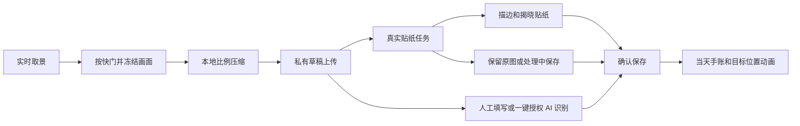

# FoodDiary 拍照与贴纸

## Web 拍照

API 模式底部中央按钮直接打开应用内相机。应用通过 `CameraProvider.open` 请求视频权限，默认优先后置镜头，关闭音频。`CameraSession.attach` 使用带 `playsinline` 的静音视频作实时取景。切换镜头时先结束上一会话，补光只在设备报告支持后出现。系统相机和相册都经过同一个 `select` 接口，返回 File、宽高和方向信息。

生产需要浏览器信任的 HTTPS。同源相机许可通过 `Permissions-Policy` 生效，麦克风及定位保持关闭。CSP 允许应用自己的脚本、同源 API 和受控 Blob 图片与媒体。浏览器拒绝权限、设备占用、无摄像头或接口不可用时，界面提供相册、系统拍照或手动输入。系统拍照降级是否打开系统相机由设备浏览器决定，等待 Android Chrome 与 iPhone Safari 实测。 [浏览器安全上下文和权限](https://developer.mozilla.org/en-US/docs/Web/API/MediaDevices/getUserMedia)

每次开相机持有独立 AbortController。页面退出、账号变化、关闭、切镜头和页面进入后台时释放视频轨道，迟到的权限响应同样停止。重新进入前台按「继续取景」重新开始。临时 Canvas 销毁，Blob URL 随照片、任务、组件或当前账号销毁。正式手账仍需主动保存。

## 照片、抠图和保存

- `WebCameraProvider` 只提交按快门后生成的一张照片，Canvas 最长边 1600 px、JPEG 首次压缩质量 0.88，超过约 768 KiB 再尝试 0.76。相册在超出范围时尝试同样压缩。小体积 JPEG、PNG、WebP 可以原样走上传，由服务端做私有规范化、EXIF 移除、体积及像素验证。
- `ApiMealForm` 复用现有媒体上传，按照片共享同一上传 Promise。独立贴纸任务和经许可的 AI 识别均可使用该照片，无需等对方完成。AI 按钮沿用供应商确认和后端费用控制。保存复用餐次幂等键和编辑版本号。
- `useDraftStickers` 复用原有任务创建、轮询和重试，网络恢复后重查。重新拍摄清除旧照片上下文和预览。取消时尽可能撤销旧贴纸任务并移除无引用草稿。请求结果未知或仍有其他引用的源图由后端保留与既有孤立回收处理。
- `CaptureSticker` 对上传后产生的真实任务显示扫描光，收到透明抠图和白边 WebP 后才使用真实 Alpha 浮现轮廓，约 0.95 秒内渐隐原背景、抬升主体、出现成品。现有抠图是裁去透明边后的居中构图，动画不逐像素配准到原图。关闭特效或系统减少动态效果时直接展示成品。
- API 确认保存后，内存中的贴纸和起始位置转给当天手账。找到对应记录及媒体位置后通过 Web Animations API 播放 660 ms 入账动画，提供 CSS 降级。失败或尚无贴纸时保留对应状态，完成任务后手账可再读取贴纸。跳转、过期或账号切换释放临时数据。最终照片旋转由既有媒体标识稳定决定。
- Alembic `0009_meal_photo_display` 将「使用原图」保存在餐次的图片关联。旧关联继续优先使用可用贴纸。本人手账、月历和图鉴读取记录选择。好友仅在原图权限明确获准时获得原图，拥有贴纸权限的好友无法通过旧地址读取被设置为原图的该条记录贴纸。

## Android 适配

阶段 8 由原生适配器实现 `CameraProvider`，把原生拍摄结果转换为同一 `CapturedPhoto`，沿用这里的上传、贴纸、授权及保存流程。应用需验证目标 Capacitor 版本、Android 权限、相册选取、前后台生命周期、配置切换，以及进程被系统回收后按账号恢复 `appRestoredResult`。标准 Camera 插件适合系统相机交互。定制实时取景优先评估维护中的 CameraX 或相机预览适配，由 Android 真机验证触控和捕获方向。 [Capacitor Camera](https://capacitorjs.com/docs/apis/camera)

## 验证

以阶段报告的实际运行记录为准。测试用本地 Windows Chrome 及文件驱动的虚拟摄像头，真实 ONNX Worker 在同机运行。Android Chrome、iPhone Safari、实物摄像头、实际启用补光及 HTTPS 生产链路等待真机。 [阶段 7.2 报告](PHASE-7.2.md)
